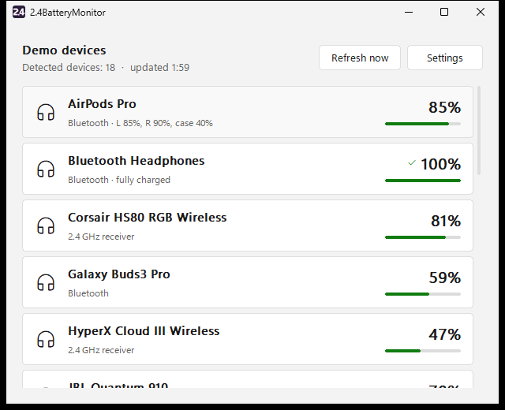
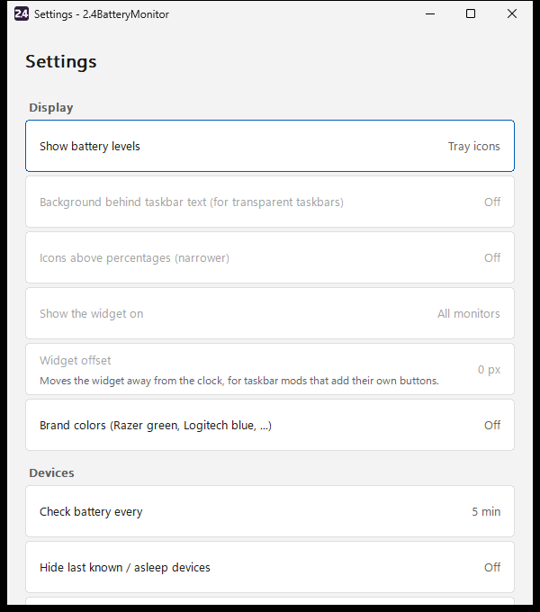
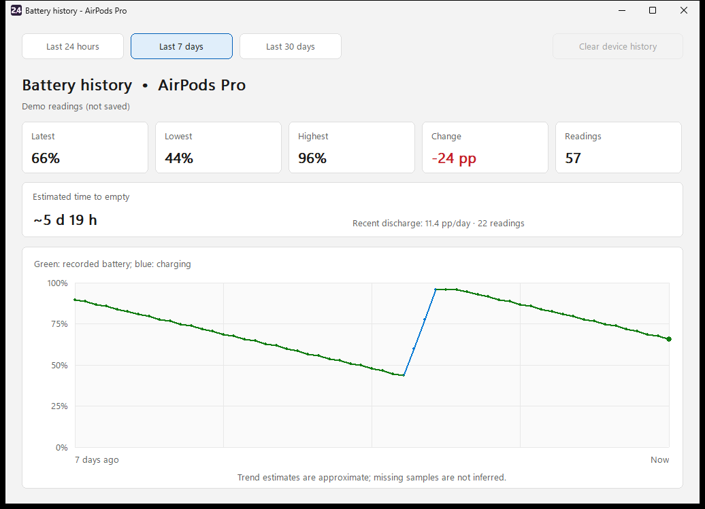
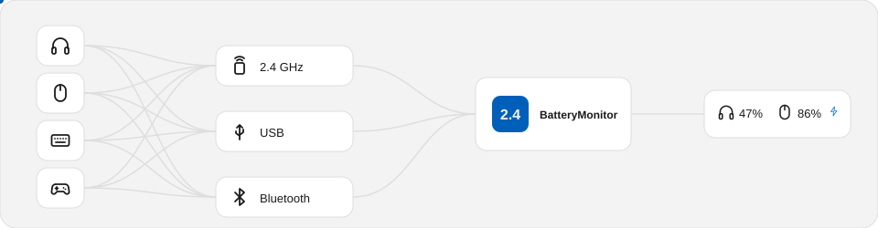

<div align="center">


# 2.4BatteryMonitor

**Battery levels of your wireless mouse, keyboard, headset and controller, right on the Windows taskbar.**<br>
No vendor software, no account, no network. One small EXE.

[Русский](README.md) · **English** · [中文](README.zh-CN.md)

[](https://github.com/SunsetSH/2.4BatteryMonitor/releases/latest)
[](https://github.com/SunsetSH/2.4BatteryMonitor/actions/workflows/ci.yml)


[](LICENSE)

<picture>
  <source media="(prefers-color-scheme: dark)" srcset="docs/images/hero-dark.svg">
  
</picture>

### [Download the latest version](https://github.com/SunsetSH/2.4BatteryMonitor/releases/latest)

</div>

## Why

Checking the battery of a mouse, a headset and a controller usually means keeping G HUB, Synapse, iCUE and a couple
more apps open. 2.4BatteryMonitor reads the level straight from the receiver, cable or Bluetooth and shows it all
in one place: next to the clock on every monitor, also over a fullscreen game.

<table>
<tr>
<td width="50%" valign="top">

**100+ device families**<br>
Logitech, Razer, SteelSeries, Corsair, HyperX, Sony, Xbox, Samsung, AirPods and dozens of smaller brands.
[Full list](docs/DEVICES.md).

</td>
<td width="50%" valign="top">

**Read-only**<br>
Devices it recognises only get battery queries. Settings, lighting and profiles are never written
([exact rule](CONTRIBUTING.md#rules-for-drivers)).

</td>
</tr>
<tr>
<td valign="top">

**Widget or tray icons**<br>
An icon and a percentage per device on the taskbar, or a battery icon per device in the tray. Red is low, orange
is soon low, a blue bolt is charging.

</td>
<td valign="top">

**Alerts and reminders**<br>
A low-battery threshold per device, a "charged to 80%" reminder, and quiet while a fullscreen game runs.

</td>
</tr>
<tr>
<td valign="top">

**History and forecast**<br>
A battery chart for 24 hours, 7 and 30 days and a time-to-empty estimate. Everything stays on your PC.

</td>
<td valign="top">

**15 languages**<br>
English, Russian, Chinese and 12 more. Follows the Windows language; add your own with one text file.

</td>
</tr>
</table>

## What it looks like

<table>
<tr>
<td width="50%" align="center" valign="top">
<picture>
  <source media="(prefers-color-scheme: dark)" srcset="docs/images/overview-en-dark.png">
  
</picture>
<br><sub><b>Device overview.</b> A card per device: level, connection, charging, time to empty. Click for the
history, right-click for the menu, drag to reorder.</sub>
</td>
<td width="50%" align="center" valign="top">
<picture>
  <source media="(prefers-color-scheme: dark)" srcset="docs/images/settings-en-dark.png">
  
</picture>
<br><sub><b>Settings.</b> Display, refresh, ignored devices, notifications, language and updates in one
window.</sub>
</td>
</tr>
<tr>
<td colspan="2" align="center">
<picture>
  <source media="(prefers-color-scheme: dark)" srcset="docs/images/history-en-dark.png">
  
</picture>
<br><sub><b>Battery history.</b> The green line is the recorded level, blue parts are charging. The time-to-empty
estimate appears once there is enough data.</sub>
</td>
</tr>
</table>

The windows follow the Windows light or dark theme. Try the interface without your own devices:
`2.4BatteryMonitor.exe --demo`.

## Quick start

1. Download `2.4BatteryMonitor-Setup-<version>.exe` from
   [Releases](https://github.com/SunsetSH/2.4BatteryMonitor/releases/latest) and run it (no administrator rights
   needed). Without installing: unpack `2.4BatteryMonitor-<version>-portable.zip` anywhere.
2. Start 2.4BatteryMonitor. The device overview opens and the levels appear in the tray.
3. Want percentages right on the taskbar? **Settings → Show battery levels → Taskbar widget.** Startup with
   Windows is there too.

> [!TIP]
> Windows 11 may put a new tray icon into the overflow menu. Drag it out or turn it on under
> **Settings → Personalization → Taskbar → Other system tray icons**.

Your device is missing? The overview has a **Report a missing device** button: it opens a prefilled GitHub issue
that you check and submit yourself.

## How it works

<picture>
  <source media="(prefers-color-scheme: dark)" srcset="docs/images/flow-dark.svg">
  
</picture>

- Every driver recognises its devices exactly by vendor and product ID (VID and PID) and only sends battery read
  queries. Unknown devices are never written to.
- Protocols come from open-source projects and vendor documentation, listed in [CREDITS.md](CREDITS.md). The
  [table](docs/DEVICES.md#hardware-tested) shows which devices were tested on real hardware.
- It polls once a minute (more or less often if you like) and pauses while the screen is locked or off.

## Colors and icons

| You see | Meaning |
|---|---|
| Red number | At or below the device's alert threshold (15% by default) |
| Orange number | Up to 15 points above that threshold |
| Blue bolt | Charging |
| Green check mark | Fully charged and still on power |
| Dimmed text | Asleep, the last known value is shown |
| Dimmed `×` | The wireless link is down (only with *Show disconnected devices*) |
| Tiny caption `MX`, `PRO`, `2` | Two devices of the same kind, told apart by name or number |

<details>
<summary><b>More about the widget and icons</b></summary>

- **Several monitors:** the widget shows next to the clock on every monitor's taskbar. Settings can keep it on the
  main monitor or one chosen monitor.
- **Transparent taskbar** (for example Windhawk's Taskbar Styler): turn on *Background behind taskbar text*.
- **Icons above percentages** save width. Left and right taskbars get a column of devices.
- **Brand colors:** devices of 16 known brands get their maker's color with a glow and a level bar. Red, orange and
  blue always win over a brand color.
- **Custom names:** *Rename device...* in the device menu. Only the interface changes.
- **Order:** drag the cards in the overview or press Ctrl+arrow.

</details>

## Alerts and history

<details>
<summary><b>When a low-battery alert fires</b></summary>

Each device menu has **Battery alerts**: default 15%, off, or a threshold from 5% to 40%.

- It needs a fresh 0–100% reading while the device is connected, awake and not charging.
- It fires once and re-arms when the level climbs more than 10 points above the threshold or charging starts.
- **Charge reminder** (80%, 90% or 100%) tells you once when a device on power reaches that level, so you can
  unplug it.
- **Quiet in full-screen apps** (on by default) holds notifications while a game or presentation runs full screen
  and shows them afterwards.

</details>

<details>
<summary><b>What the history records and where</b></summary>

- Connected, awake devices with a numeric level, at most once per 30 minutes per device.
- Kept for up to 30 days in `%LOCALAPPDATA%\2.4BatteryMonitor\battery_history.tsv`, under about 2 MB. Nothing is
  sent over the network.
- The time-to-empty estimate needs four readings, two hours and a 3-point decline. It is a trend, not a guarantee.
- *Record battery history* in the settings turns recording off.

</details>

## Supported devices

Mice, keyboards, headsets, earbuds and controllers over their 2.4 GHz receiver, USB cable or Bluetooth:

> 8BitDo · AJAZZ · AKG · Akko · Alienware · Apple AirPods / Beats · Arbiter Studio · Areson · ASTRO · ASUS ROG ·
> ATK / VXE · Attack Shark · Audeze · AULA · BEITONG · CHERRY · Cooler Master · Corsair · DAREU · DARKRIM ·
> Darmoshark · Delux · Endgame Gear · ENDORFY · EPOMAKER · EWEADN · Fantech · Finalmouse · Flydigi · Fractal Design ·
> GameSir · Glorious · G-Wolves · HECATE · Hitscan · HyperX · Incott · Inphic · Jabra · JBL · Keychron · Kysona ·
> LAMZU · Logitech · Machenike · MAONO · MCHOSE · MOONDROP · Motospeed · MSI · Niceboy · Nintendo Switch ·
> Ninjutso · Nothing / CMF · NuPhy · NZXT · PlayStation · PMO · Poly · Pulsar · Rapoo · RAWM / SADES · Razer ·
> Redragon · Royal Kludge · Samsung Galaxy Buds · Scyrox · Sharkoon · Sony INZONE · Sprime · SteelSeries · Taidu ·
> Turtle Beach · VAXEE · VGN · WLMouse · Wraith · Xbox · Zenith · ZOWIE

Also any Bluetooth device whose battery Windows shows, Google Fast Pair earbuds (left, right, case), devices with
the standard HID *Battery Strength* usage, and Android phones linked with Phone Link.

**[Full table with models, receiver IDs and protocols](docs/DEVICES.md)**

Most drivers were written from protocol documentation. Own a listed device? Open its menu in the overview and
choose **Report this device**: that is how the list of tested devices grows.

<details>
<summary><b>Known limits</b></summary>

- **Sleeping devices** may not answer; their last value stays visible, dimmed.
- **Keychron keyboards:** stock firmware reports the battery only over Bluetooth. Over the receiver or cable they
  need [patched firmware](docs/keychron_keyboard_firmware/README.md).
- **Phones:** read from a file Phone Link writes for the Start menu; not a documented API.
- **GameSir Cyclone Pro:** the level is read over Bluetooth LE, so pair the pad with Windows once.
  [Details](docs/gamesir_cyclone_pro.md).
- **Rapoo:** VT mice push their status; waiting up to 5 seconds does not delay other devices.
  [Notes](docs/rapoo.md).
- **Not supported yet** (protocol undocumented): other MSI mice and keyboards, Razer Kraken, HyperX Pulsefire other
  than the Haste 2, Xbox Wireless Headset on the Xbox adapter (works over Bluetooth), HECATE G2 Wireless 7.1, the
  Baseus AeQur GH02 dongle, Weikav Lucky65 v1. A USB capture from an owner is the way to add them
  ([how](CONTRIBUTING.md#adding-a-device)).

</details>

## Command line

```text
2.4BatteryMonitor.exe --list        # every device and its battery level, then exit
2.4BatteryMonitor.exe --json        # a JSON array of devices for scripts and status bars
2.4BatteryMonitor.exe --dump        # HID collections, USB and Bluetooth devices
2.4BatteryMonitor.exe --timing      # how long each driver took in one poll
2.4BatteryMonitor.exe --demo        # sample devices of every brand
2.4BatteryMonitor.exe --background  # start in the notification area
2.4BatteryMonitor.exe --quit        # close the running instance
```

<details>
<summary><b>JSON format and status.json</b></summary>

```json
[{"key":"kysona:373B:1085","name":"CX Wireless mouse","via":"2.4 GHz receiver","kind":"mouse",
  "percent":85,"level":"","detail":"","charging":false,"asleep":false,"connected":true,
  "millivolts":4029,"graceSec":1800,"left":-1,"right":-1,"case":-1}]
```

The fields are stable: new ones may be added, existing ones do not change. `left`, `right` and `case` are earbud
levels (-1 when not reported). With *Write status.json for other apps* the same array appears after every poll in
`%LOCALAPPDATA%\2.4BatteryMonitor\status.json`, for Rainmeter, Stream Deck or scripts.

</details>

## Updates

On every start (usually at sign-in) the app looks up the number of the latest stable GitHub release once
(turn it off in the **Updates** menu). A newer version shows a Windows notification; nothing is downloaded without
your consent.
**Updates → Install version…** or a click on the notification downloads the signed file and verifies its ECDSA
signature: an installed copy starts the new installer, a portable copy replaces its EXE in the same folder and
restarts. If the folder is not writable, the release page opens instead.

The installer closes a running portable copy and moves its startup entry to the installed one; settings and
history are shared.

## Linux (experimental)

The Linux build uses the same drivers over hidraw with a GTK4 tray icon. Besides the vendor drivers it shows every
battery the kernel already reads (`/sys/class/power_supply`): Bluetooth HID, Logitech HID++, Sony, Nintendo and
Steam controllers. Building and the udev rule: [docs/DEVELOPERS.md](docs/DEVELOPERS.md#linux-build).

## Translations

Built in: English, العربية, Deutsch, Español, Français, עברית, 日本語, 한국어, Polski, Português (Brasil), Русский,
Türkçe, Українська, 简体中文 and 繁體中文. Each language is one UTF-8 file in [`lang/`](lang).
*Settings → Language → Add your own language...* opens a folder with the template; a new language appears in the
menu without a restart. Please send translation improvements as a pull request.

## Contributing

- Tested a device? **Report this device** in its menu, or use the
  [issue forms](https://github.com/SunsetSH/2.4BatteryMonitor/issues/new/choose).
- Adding a device or changing code: [CONTRIBUTING.md](CONTRIBUTING.md) and
  [docs/DEVELOPERS.md](docs/DEVELOPERS.md) (build, project map, tests).

## Credits and license

Protocol knowledge comes from many open-source projects and vendor tools; see [CREDITS.md](CREDITS.md).

[GNU General Public License v3.0 or later](LICENSE). You may use, modify and redistribute this software, but
anything you distribute that is based on it must be released under the same license, with its source code.
