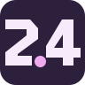
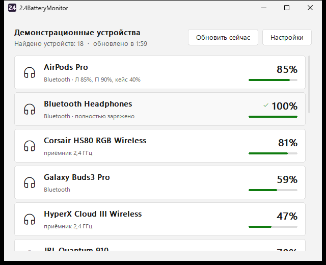
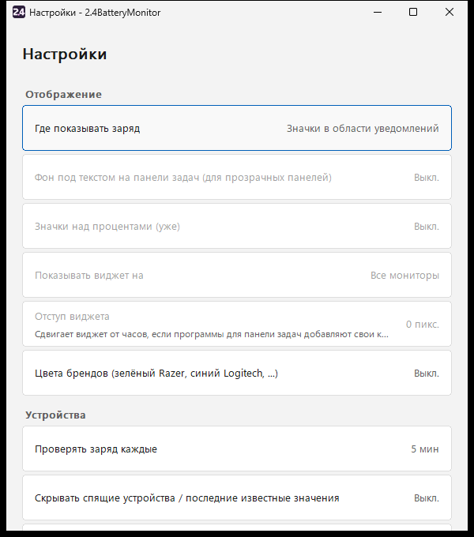
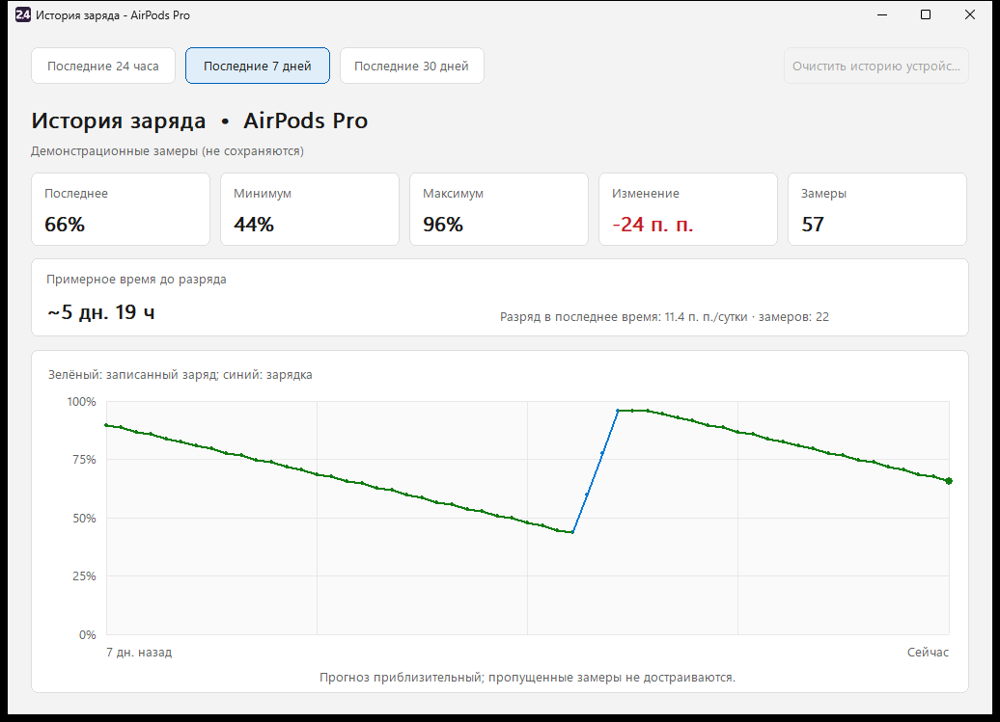
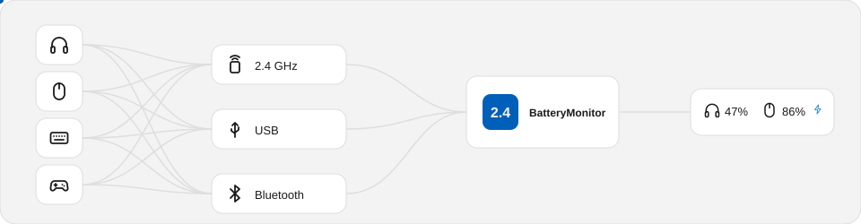

<div align="center">



# 2.4BatteryMonitor

**Заряд беспроводных мышей, клавиатур, гарнитур и геймпадов прямо на панели задач Windows.**<br>
Без фирменных программ, без учётных записей и без интернета. Один небольшой EXE.

**Русский** · [English](README.en.md) · [中文](README.zh-CN.md)

[](https://github.com/SunsetSH/2.4BatteryMonitor/releases/latest)
[](https://github.com/SunsetSH/2.4BatteryMonitor/actions/workflows/ci.yml)


[](LICENSE)

<picture>
  <source media="(prefers-color-scheme: dark)" srcset="docs/images/hero-dark.svg">
  
</picture>

### [Скачать последнюю версию](https://github.com/SunsetSH/2.4BatteryMonitor/releases/latest)

</div>

## Зачем это нужно

Чтобы узнать заряд мыши, гарнитуры и геймпада, обычно приходится держать открытыми G HUB, Synapse, iCUE и ещё
пару программ. 2.4BatteryMonitor читает заряд напрямую через приёмник, кабель или Bluetooth и показывает всё в одном
месте: рядом с часами на каждом мониторе, в том числе поверх полноэкранной игры.

<table>
<tr>
<td width="50%" valign="top">

**Больше 100 семейств устройств**<br>
Logitech, Razer, SteelSeries, Corsair, HyperX, Sony, Xbox, Samsung, AirPods и десятки небольших брендов.
[Полный список](docs/DEVICES.md).

</td>
<td width="50%" valign="top">

**Только чтение**<br>
Устройствам, которые программа узнала, она отправляет только запросы заряда. Настройки, подсветку и профили не
записывает ([точное правило](CONTRIBUTING.md#rules-for-drivers)).

</td>
</tr>
<tr>
<td valign="top">

**Виджет или значки**<br>
Значок и процент для каждого устройства на панели задач или отдельный значок батареи в трее. Красный значит мало,
оранжевый скоро мало, синяя молния значит зарядку.

</td>
<td valign="top">

**Уведомления и напоминания**<br>
Свой порог разряда для каждого устройства, напоминание «заряжено до 80%», тишина во время полноэкранных игр.

</td>
</tr>
<tr>
<td valign="top">

**История и прогноз**<br>
График заряда за 24 часа, 7 и 30 дней и оценка времени до разряда. Всё хранится только у вас на компьютере.

</td>
<td valign="top">

**15 языков**<br>
Русский, английский, китайский и ещё 12. Язык берётся из Windows, свой язык добавляется одним текстовым файлом.

</td>
</tr>
</table>

## Как это выглядит

<table>
<tr>
<td width="50%" align="center" valign="top">
<picture>
  <source media="(prefers-color-scheme: dark)" srcset="docs/images/overview-ru-dark.png">
  
</picture>
<br><sub><b>Обзор устройств.</b> Карточка на каждое устройство: уровень, подключение, зарядка, время до разряда.
Клик открывает историю, правый клик меню, карточки можно перетаскивать.</sub>
</td>
<td width="50%" align="center" valign="top">
<picture>
  <source media="(prefers-color-scheme: dark)" srcset="docs/images/settings-ru-dark.png">
  
</picture>
<br><sub><b>Настройки.</b> Отображение, опрос, игнорируемые устройства, уведомления, язык и обновления в одном
окне.</sub>
</td>
</tr>
<tr>
<td colspan="2" align="center">
<picture>
  <source media="(prefers-color-scheme: dark)" srcset="docs/images/history-ru-dark.png">
  
</picture>
<br><sub><b>История заряда.</b> Зелёная линия показывает записанный уровень, синие участки зарядку. Оценка времени
до разряда появляется, когда данных достаточно.</sub>
</td>
</tr>
</table>

Окна следуют светлой или тёмной теме Windows. Попробовать интерфейс без своих устройств можно командой
`2.4BatteryMonitor.exe --demo`.

## Быстрый старт

1. Скачайте `2.4BatteryMonitor-<версия>-portable.zip` со страницы
   [Releases](https://github.com/SunsetSH/2.4BatteryMonitor/releases/latest) и распакуйте в любую папку.
2. Запустите `2.4BatteryMonitor.exe`. Откроется обзор устройств, заряд появится в трее.
3. Хотите проценты прямо на панели задач? **Настройки → Где показывать заряд → Виджет на панели задач.**
   Там же автозапуск вместе с Windows.

> [!TIP]
> Windows 11 может спрятать новый значок в меню скрытых значков. Вытащите его на панель или включите в
> **Параметры → Персонализация → Панель задач → Другие значки в области уведомлений**.

Устройства нет в списке? В обзоре есть кнопка **«Сообщить о ненайденном устройстве»**: она откроет на GitHub
заполненное обращение, вы его проверите и отправите сами.

## Как это работает

<picture>
  <source media="(prefers-color-scheme: dark)" srcset="docs/images/flow-dark.svg">
  
</picture>

- Каждый драйвер узнаёт свои устройства точно по коду производителя и модели (VID и PID) и отправляет только
  запросы чтения заряда. Незнакомым устройствам программа ничего не пишет.
- Протоколы взяты из открытых проектов и документации производителей, источники перечислены в
  [CREDITS.md](CREDITS.md). Какие устройства проверены на реальном железе, видно в
  [таблице](docs/DEVICES.md#hardware-tested).
- Опрос идёт раз в минуту (можно чаще или реже) и останавливается, пока экран заблокирован или выключен.

## Цвета и значки

| Что видно | Что это значит |
|---|---|
| Красное число | Не выше порога уведомлений устройства (по умолчанию 15%) |
| Оранжевое число | До 15 пунктов выше этого порога |
| Синяя молния | Заряжается |
| Зелёная галочка | Заряжено полностью и всё ещё на зарядке |
| Бледный текст | Устройство спит, показано последнее значение |
| Бледный `×` | Радиосвязь потеряна (только с *Показывать отключённые устройства*) |
| Маленькая подпись `MX`, `PRO`, `2` | Два устройства одного типа, различаются по имени или номеру |

<details>
<summary><b>Больше о виджете и значках</b></summary>

- **Несколько мониторов:** виджет показывается у часов на панели задач каждого монитора. В настройках можно
  оставить его только на основном или на одном выбранном мониторе.
- **Прозрачная панель задач** (например, Taskbar Styler из Windhawk): включите *Фон под текстом на панели задач*.
- **Значки над процентами** экономят ширину. На вертикальной панели задач устройства идут столбиком.
- **Цвета брендов:** у 16 известных брендов значок окрашен в фирменный цвет, со свечением и полоской уровня.
  Красный, оранжевый и синий цвет бренда не перекрывает.
- **Свои имена:** *Переименовать устройство...* в меню устройства. Имя меняется только в интерфейсе.
- **Порядок:** перетащите карточки в обзоре или нажмите Ctrl+стрелку.

</details>

## Уведомления и история

<details>
<summary><b>Когда приходит уведомление о разряде</b></summary>

В меню каждого устройства есть **Уведомления о заряде**: по умолчанию 15%, отключить или порог от 5% до 40%.

- Нужно свежее значение 0–100%, устройство подключено, не спит и не заряжается.
- Уведомление приходит один раз. Снова оно сработает, когда уровень поднимется больше чем на 10 пунктов выше
  порога или начнётся зарядка.
- **Напоминание о зарядке** (80%, 90% или 100%) один раз сообщает, что устройство на зарядке дошло до этого уровня
  и его можно отключить.
- **Тишина в полноэкранных приложениях** (включена по умолчанию) придерживает уведомления, пока открыта игра или
  презентация, и показывает их после.

</details>

<details>
<summary><b>Что записывается в историю и где</b></summary>

- Записываются подключённые и не спящие устройства с числовым процентом, не чаще раза в 30 минут на устройство.
- Данные хранятся до 30 дней в `%LOCALAPPDATA%\2.4BatteryMonitor\battery_history.tsv`, файл не больше 2 МБ.
  В сеть ничего не отправляется.
- Для оценки времени до разряда нужны четыре замера, два часа наблюдений и падение на 3 пункта. Это тренд, а не
  гарантия.
- *Записывать историю заряда* в настройках выключает запись.

</details>

## Поддерживаемые устройства

Мыши, клавиатуры, гарнитуры, наушники и геймпады через 2.4 ГГц приёмник, USB-кабель или Bluetooth:

> 8BitDo · AJAZZ · AKG · Akko · Alienware · Apple AirPods / Beats · Arbiter Studio · Areson · ASTRO · ASUS ROG ·
> ATK / VXE · Attack Shark · Audeze · AULA · BEITONG · CHERRY · Cooler Master · Corsair · DAREU · DARKRIM ·
> Darmoshark · Delux · Endgame Gear · ENDORFY · EPOMAKER · EWEADN · Fantech · Finalmouse · Flydigi · Fractal Design ·
> GameSir · Glorious · G-Wolves · HECATE · Hitscan · HyperX · Incott · Inphic · Jabra · JBL · Keychron · Kysona ·
> LAMZU · Logitech · Machenike · MAONO · MCHOSE · MOONDROP · Motospeed · MSI · Niceboy · Nintendo Switch ·
> Ninjutso · Nothing / CMF · NuPhy · NZXT · PlayStation · PMO · Poly · Pulsar · Rapoo · RAWM / SADES · Razer ·
> Redragon · Royal Kludge · Samsung Galaxy Buds · Scyrox · Sharkoon · Sony INZONE · Sprime · SteelSeries · Taidu ·
> Turtle Beach · VAXEE · VGN · WLMouse · Wraith · Xbox · Zenith · ZOWIE

А также любое Bluetooth-устройство, заряд которого показывает Windows; наушники Google Fast Pair (левый, правый,
кейс); устройства со стандартным HID *Battery Strength*; Android-телефоны, связанные через Phone Link.

**[Полная таблица: модели, ID приёмников и протоколы](docs/DEVICES.md)**

Большая часть драйверов написана по документации протоколов. Если у вас устройство из списка, откройте его меню в
обзоре и выберите **«Сообщить об этом устройстве»**: так проверенных устройств становится больше.

<details>
<summary><b>Известные ограничения</b></summary>

- **Спящие устройства** могут не отвечать; их последнее значение остаётся бледным.
- **Клавиатуры Keychron:** штатная прошивка сообщает заряд только по Bluetooth. Через приёмник или кабель нужна
  [пропатченная прошивка](docs/keychron_keyboard_firmware/README.md).
- **Телефоны:** заряд читается из файла, который Phone Link пишет для меню «Пуск»; это не документированный API.
- **GameSir Cyclone Pro:** уровень читается по Bluetooth LE, поэтому один раз сопрягите геймпад с Windows.
  [Подробности](docs/gamesir_cyclone_pro.md).
- **Rapoo:** мыши VT сами присылают состояние, ожидание до 5 секунд не задерживает другие устройства.
  [Заметки](docs/rapoo.md).
- **Пока не поддерживаются** (протокол не описан): другие мыши и клавиатуры MSI, Razer Kraken, HyperX Pulsefire
  кроме Haste 2, Xbox Wireless Headset через адаптер Xbox (по Bluetooth работает), HECATE G2 Wireless 7.1, донгл
  Baseus AeQur GH02, Weikav Lucky65 v1. Добавить их можно по USB-дампу от владельца
  ([как](CONTRIBUTING.md#adding-a-device)).

</details>

## Командная строка

```text
2.4BatteryMonitor.exe --list        # все устройства и заряд, затем выход
2.4BatteryMonitor.exe --json        # JSON-массив устройств для скриптов и панелей
2.4BatteryMonitor.exe --dump        # HID-коллекции, USB и Bluetooth-устройства
2.4BatteryMonitor.exe --timing      # сколько занял каждый драйвер в одном опросе
2.4BatteryMonitor.exe --demo        # демо-устройства всех брендов
2.4BatteryMonitor.exe --background  # запуститься сразу в области уведомлений
2.4BatteryMonitor.exe --quit        # закрыть запущенный экземпляр
```

<details>
<summary><b>Формат JSON и status.json</b></summary>

```json
[{"key":"kysona:373B:1085","name":"CX Wireless mouse","via":"2.4 GHz receiver","kind":"mouse",
  "percent":85,"level":"","detail":"","charging":false,"asleep":false,"connected":true,
  "millivolts":4029,"graceSec":1800,"left":-1,"right":-1,"case":-1}]
```

Поля стабильны: новые могут добавляться, существующие не меняются. `left`, `right` и `case` дают уровни наушников
(-1, если не сообщаются). С настройкой *Записывать status.json для других программ* тот же массив после каждого
опроса появляется в `%LOCALAPPDATA%\2.4BatteryMonitor\status.json` для Rainmeter, Stream Deck или скриптов.

</details>

## Обновления

**Обновления** в меню проверяют последний стабильный релиз на GitHub. Автоматическая проверка по умолчанию
выключена. Портативная копия открывает страницу релиза; копия из установщика скачивает подписанный установщик и
проверяет подпись ECDSA перед запуском.

## Linux (экспериментально)

Linux-сборка использует те же драйверы через hidraw и показывает значок в трее GTK4. Кроме драйверов производителей
она берёт заряд, который уже читает ядро (`/sys/class/power_supply`): Bluetooth HID, Logitech HID++, контроллеры
Sony, Nintendo и Steam. Сборка и правило udev описаны в [docs/DEVELOPERS.md](docs/DEVELOPERS.md#linux-build).

## Переводы

Встроены: English, العربية, Deutsch, Español, Français, עברית, 日本語, 한국어, Polski, Português (Brasil), Русский,
Türkçe, Українська, 简体中文 и 繁體中文. Каждый язык это один UTF-8 файл в [`lang/`](lang). *Настройки → Язык →
Добавить свой язык...* открывает папку с шаблоном, новый язык появляется в меню без перезапуска. Улучшения переводов
присылайте пулл-реквестом.

## Участие

- Проверили устройство? **«Сообщить об этом устройстве»** в его меню или
  [форма обращения](https://github.com/SunsetSH/2.4BatteryMonitor/issues/new/choose).
- Хотите добавить устройство или поправить код: [CONTRIBUTING.md](CONTRIBUTING.md) и
  [docs/DEVELOPERS.md](docs/DEVELOPERS.md) (сборка, карта проекта, тесты).

## Благодарности и лицензия

Знания о протоколах взяты из многих открытых проектов и программ производителей, список в [CREDITS.md](CREDITS.md).

[GNU General Public License v3.0 или новее](LICENSE). Программу можно использовать, изменять и распространять, но
всё, что вы распространяете на её основе, должно выходить под той же лицензией вместе с исходным кодом.
