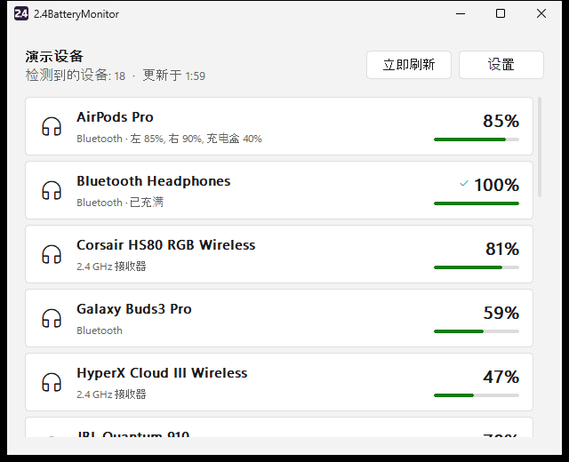
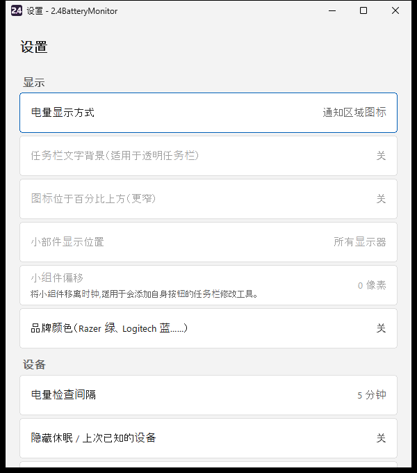
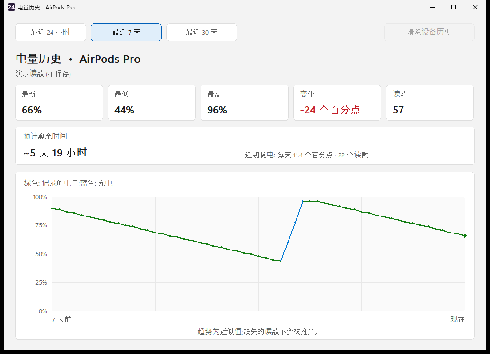
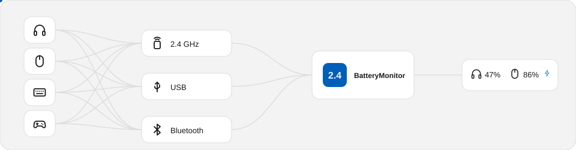

<div align="center">


# 2.4BatteryMonitor

**在 Windows 任务栏上直接显示无线鼠标、键盘、耳机和手柄的电量。**<br>
无需厂商软件，无需账号，不联网。只有一个小巧的 EXE。

[Русский](README.md) · [English](README.en.md) · **中文**

[](https://github.com/SunsetSH/2.4BatteryMonitor/releases/latest)
[](https://github.com/SunsetSH/2.4BatteryMonitor/actions/workflows/ci.yml)


[](LICENSE)

<picture>
  <source media="(prefers-color-scheme: dark)" srcset="docs/images/hero-dark.svg">
  
</picture>

### [下载最新版本](https://github.com/SunsetSH/2.4BatteryMonitor/releases/latest)

</div>

## 为什么需要它

想同时知道鼠标、耳机和手柄的电量，通常要一直开着 G HUB、Synapse、iCUE 等好几个程序。2.4BatteryMonitor
直接通过接收器、数据线或蓝牙读取电量，并集中显示在一个地方：每台显示器的时钟旁边，全屏游戏时也看得到。

<table>
<tr>
<td width="50%" valign="top">

**100 多个设备系列**<br>
Logitech、Razer、SteelSeries、Corsair、HyperX、Sony、Xbox、Samsung、AirPods 以及几十个小众品牌。
[完整列表](docs/DEVICES.md)。

</td>
<td width="50%" valign="top">

**只读**<br>
对识别出的设备只发送电量查询，从不写入设置、灯效或配置文件（[具体规则](CONTRIBUTING.md#rules-for-drivers)）。

</td>
</tr>
<tr>
<td valign="top">

**小组件或托盘图标**<br>
在任务栏上为每个设备显示图标和百分比，或在托盘中为每个设备显示一个电池图标。红色表示电量低，橙色表示即将变低，
蓝色闪电表示正在充电。

</td>
<td valign="top">

**提醒**<br>
每个设备单独设置低电量阈值，“已充电至 80%”提醒，全屏游戏时保持安静。

</td>
</tr>
<tr>
<td valign="top">

**历史与预测**<br>
24 小时、7 天和 30 天的电量图表以及剩余时间估算。所有数据只保存在你的电脑上。

</td>
<td valign="top">

**15 种语言**<br>
中文、英文、俄文等 15 种语言。跟随 Windows 语言，也可以用一个文本文件添加自己的语言。

</td>
</tr>
</table>

## 界面预览

<table>
<tr>
<td width="50%" align="center" valign="top">
<picture>
  <source media="(prefers-color-scheme: dark)" srcset="docs/images/overview-zh-CN-dark.png">
  
</picture>
<br><sub><b>设备概览。</b>每个设备一张卡片：电量、连接方式、充电状态、剩余时间。单击查看历史，右键打开菜单，
拖动卡片调整顺序。</sub>
</td>
<td width="50%" align="center" valign="top">
<picture>
  <source media="(prefers-color-scheme: dark)" srcset="docs/images/settings-zh-CN-dark.png">
  
</picture>
<br><sub><b>设置。</b>显示方式、检查间隔、忽略的设备、通知、语言和更新都在一个窗口中。</sub>
</td>
</tr>
<tr>
<td colspan="2" align="center">
<picture>
  <source media="(prefers-color-scheme: dark)" srcset="docs/images/history-zh-CN-dark.png">
  
</picture>
<br><sub><b>电量历史。</b>绿线是记录的电量，蓝色部分是充电。数据足够时会显示剩余时间估算。</sub>
</td>
</tr>
</table>

窗口跟随 Windows 的浅色或深色主题。没有设备也能体验界面：`2.4BatteryMonitor.exe --demo`。

## 快速开始

1. 从 [Releases](https://github.com/SunsetSH/2.4BatteryMonitor/releases/latest) 下载
   `2.4BatteryMonitor-<版本>-portable.zip`，解压到任意文件夹。
2. 运行 `2.4BatteryMonitor.exe`。设备概览会打开，电量显示在托盘中。
3. 想直接在任务栏上看到百分比？**设置 → 电量显示方式 → 任务栏小组件。**开机启动也在这里设置。

> [!TIP]
> Windows 11 可能会把新的托盘图标放进隐藏图标菜单。可以把它拖出来，或在
> **设置 → 个性化 → 任务栏 → 其他系统托盘图标** 中打开。

找不到你的设备？概览中有 **报告未找到的设备** 按钮：它会在 GitHub 上打开一个已填好的问题，由你检查后自己提交。

## 工作原理

<picture>
  <source media="(prefers-color-scheme: dark)" srcset="docs/images/flow-dark.svg">
  
</picture>

- 每个驱动按厂商和型号 ID（VID 和 PID）精确识别自己的设备，只发送读取电量的请求。程序从不向未知设备写入任何内容。
- 协议来自开源项目和厂商文档，来源列在 [CREDITS.md](CREDITS.md) 中。哪些设备已在真实硬件上测试，见
  [设备表](docs/DEVICES.md#hardware-tested)。
- 默认每分钟检查一次（可以调整），屏幕锁定或关闭时暂停。

## 颜色与图标

| 显示 | 含义 |
|---|---|
| 红色数字 | 不高于该设备的提醒阈值（默认 15%） |
| 橙色数字 | 比该阈值高出不超过 15 个百分点 |
| 蓝色闪电 | 正在充电 |
| 绿色对勾 | 已充满且仍在充电 |
| 浅色文字 | 设备休眠，显示最后已知的值 |
| 浅色 `×` | 无线连接已断开（仅在开启 *显示已断开的设备* 时） |
| 小标签 `MX`、`PRO`、`2` | 两个同类设备，用名称或编号区分 |

<details>
<summary><b>更多关于小组件和图标</b></summary>

- **多台显示器：** 小组件显示在每台显示器任务栏的时钟旁。可以在设置中只保留在主显示器或某一台显示器上。
- **透明任务栏**（例如 Windhawk 的 Taskbar Styler）：打开 *任务栏文字背景*。
- **图标在百分比上方** 可以节省宽度。任务栏在左侧或右侧时设备竖向排列。
- **品牌颜色：** 16 个已知品牌的设备使用品牌色，带光晕和电量条。红色、橙色和蓝色始终优先于品牌色。
- **自定义名称：** 设备菜单中的 *重命名设备...*。只改变界面中的名称。
- **顺序：** 在概览中拖动卡片，或按 Ctrl+方向键。

</details>

## 提醒与历史

<details>
<summary><b>何时发出低电量提醒</b></summary>

每个设备的菜单中都有 **电量提醒**：默认 15%、关闭，或 5% 到 40% 之间的阈值。

- 需要设备已连接、未休眠、未充电时的最新 0–100% 读数。
- 只提醒一次。电量回升到阈值以上 10 个百分点以上或开始充电后会重新启用。
- **充电提醒**（80%、90% 或 100%）会在充电中的设备达到该电量时提醒一次，方便你拔下充电线。
- **全屏应用时保持安静**（默认开启）在游戏或演示全屏运行时暂缓通知，结束后再显示。

</details>

<details>
<summary><b>历史记录什么、保存在哪里</b></summary>

- 只记录已连接且未休眠、有数字电量的设备，每个设备最多每 30 分钟一次。
- 最多保存 30 天，位于 `%LOCALAPPDATA%\2.4BatteryMonitor\battery_history.tsv`，大约不超过 2 MB。不会通过网络发送任何内容。
- 剩余时间估算需要 4 个读数、2 小时和 3 个百分点的下降。这是趋势，不是保证。
- 在设置中关闭 *记录电量历史* 即可停止记录。

</details>

## 支持的设备

通过 2.4 GHz 接收器、USB 数据线或蓝牙连接的鼠标、键盘、耳机和手柄：

> 8BitDo · AJAZZ · AKG · Akko · Alienware · Apple AirPods / Beats · Arbiter Studio · Areson · ASTRO · ASUS ROG ·
> ATK / VXE · Attack Shark · Audeze · AULA · BEITONG · CHERRY · Cooler Master · Corsair · DAREU · DARKRIM ·
> Darmoshark · Delux · Endgame Gear · ENDORFY · EPOMAKER · EWEADN · Fantech · Finalmouse · Flydigi · Fractal Design ·
> GameSir · Glorious · G-Wolves · HECATE · Hitscan · HyperX · Incott · Inphic · Jabra · JBL · Keychron · Kysona ·
> LAMZU · Logitech · Machenike · MAONO · MCHOSE · MOONDROP · Motospeed · MSI · Niceboy · Nintendo Switch ·
> Ninjutso · Nothing / CMF · NuPhy · NZXT · PlayStation · PMO · Poly · Pulsar · Rapoo · RAWM / SADES · Razer ·
> Redragon · Royal Kludge · Samsung Galaxy Buds · Scyrox · Sharkoon · Sony INZONE · Sprime · SteelSeries · Taidu ·
> Turtle Beach · VAXEE · VGN · WLMouse · Wraith · Xbox · Zenith · ZOWIE

此外还支持：Windows 能显示电量的任何蓝牙设备；Google Fast Pair 耳机（左耳、右耳、充电盒）；带有标准 HID
*Battery Strength* 的设备；通过“手机连接”（Phone Link）关联的 Android 手机。

**[完整设备表：型号、接收器 ID 和协议](docs/DEVICES.md)**

大多数驱动是根据协议文档编写的。如果你有列表中的设备，请在概览中打开它的菜单并选择 **报告此设备**，
这样已测试的设备就会越来越多。

<details>
<summary><b>已知限制</b></summary>

- **休眠的设备** 可能不响应；它们最后的值会以浅色显示。
- **Keychron 键盘：** 原厂固件只通过蓝牙报告电量。通过接收器或数据线需要
  [修改过的固件](docs/keychron_keyboard_firmware/README.md)。
- **手机：** 电量读取自“手机连接”为开始菜单写入的文件，这不是公开的 API。
- **GameSir Cyclone Pro：** 电量通过低功耗蓝牙读取，因此需要先把手柄与 Windows 配对一次。
  [详情](docs/gamesir_cyclone_pro.md)。
- **Rapoo：** VT 系列鼠标主动推送状态，最多 5 秒的等待不会拖慢其他设备。[说明](docs/rapoo.md)。
- **暂不支持**（协议未公开）：其他 MSI 鼠标和键盘、Razer Kraken、除 Haste 2 以外的 HyperX Pulsefire、通过 Xbox
  适配器连接的 Xbox Wireless Headset（蓝牙可用）、HECATE G2 Wireless 7.1、Baseus AeQur GH02 接收器、Weikav Lucky65 v1。
  可以根据设备主人提供的 USB 抓包添加支持（[方法](CONTRIBUTING.md#adding-a-device)）。

</details>

## 命令行

```text
2.4BatteryMonitor.exe --list        # 列出所有设备及电量后退出
2.4BatteryMonitor.exe --json        # 输出设备的 JSON 数组，供脚本和状态栏使用
2.4BatteryMonitor.exe --dump        # HID 集合、USB 和蓝牙设备
2.4BatteryMonitor.exe --timing      # 一次检查中每个驱动所用的时间
2.4BatteryMonitor.exe --demo        # 各品牌的演示设备
2.4BatteryMonitor.exe --background  # 直接在通知区域启动
2.4BatteryMonitor.exe --quit        # 关闭正在运行的实例
```

<details>
<summary><b>JSON 格式与 status.json</b></summary>

```json
[{"key":"kysona:373B:1085","name":"CX Wireless mouse","via":"2.4 GHz receiver","kind":"mouse",
  "percent":85,"level":"","detail":"","charging":false,"asleep":false,"connected":true,
  "millivolts":4029,"graceSec":1800,"left":-1,"right":-1,"case":-1}]
```

字段保持稳定：可能会新增字段，已有字段不会改变。`left`、`right` 和 `case` 是耳机各部分的电量（未报告时为 -1）。
开启 *为其他应用写入 status.json* 后，每次检查后同样的数组会写入
`%LOCALAPPDATA%\2.4BatteryMonitor\status.json`，供 Rainmeter、Stream Deck 或脚本读取。

</details>

## 更新

菜单中的 **更新** 会检查 GitHub 上最新的稳定版本。自动检查默认关闭。便携版会打开版本页面；通过安装程序安装的版本会
下载已签名的安装程序，并在运行前验证其 ECDSA 签名。

## Linux（实验性）

Linux 版本通过 hidraw 使用同样的驱动，并在 GTK4 托盘中显示图标。除厂商驱动外，它还会显示内核已经读取的电量
（`/sys/class/power_supply`）：蓝牙 HID、Logitech HID++、Sony、Nintendo 和 Steam 手柄。编译方法和 udev 规则见
[docs/DEVELOPERS.md](docs/DEVELOPERS.md#linux-build)（英文）。

## 翻译

内置：English、العربية、Deutsch、Español、Français、עברית、日本語、한국어、Polski、Português (Brasil)、Русский、
Türkçe、Українська、简体中文 和 繁體中文。每种语言是 [`lang/`](lang) 中的一个 UTF-8 文件。
*设置 → 语言 → 添加你自己的语言...* 会打开带模板的文件夹，新语言无需重启即可出现在菜单中。
欢迎通过 Pull Request 改进翻译，尤其是中文翻译。

## 参与贡献

- 测试过某个设备？在它的菜单中选择 **报告此设备**，或使用
  [问题表单](https://github.com/SunsetSH/2.4BatteryMonitor/issues/new/choose)。
- 添加设备或修改代码：[CONTRIBUTING.md](CONTRIBUTING.md) 和 [docs/DEVELOPERS.md](docs/DEVELOPERS.md)（英文：编译、项目结构、测试）。

## 致谢与许可证

协议知识来自许多开源项目和厂商工具，见 [CREDITS.md](CREDITS.md)。

[GNU 通用公共许可证 v3.0 或更高版本](LICENSE)。你可以使用、修改和再分发本软件，但基于它分发的任何内容都必须以相同的
许可证发布，并附带源代码。
